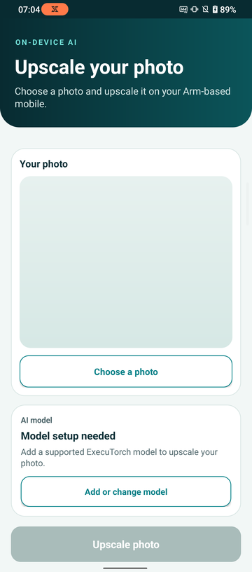
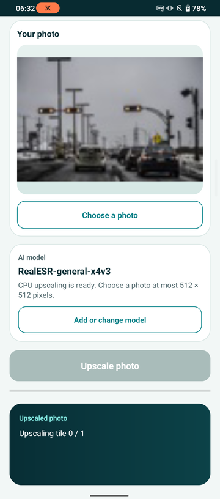
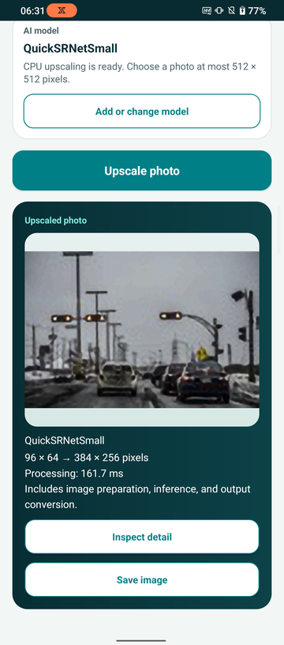
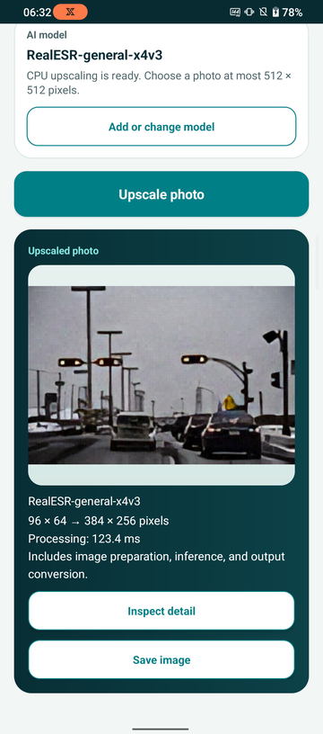

# Photo Upscale Android application

This example application accompanies the [Arm Learning Path for running upscaling models from the Arm AI Portal on Android](https://learn.arm.com/learning-paths/mobile-graphics-and-gaming/ai-portal-mobile-image-upscaling). It is intended for learning how models run on devices and is not a reference production application. It is provided under the [Arm Education End User License Agreement](LICENSE.md).

This Android application runs Arm-optimized photo-upscaling models locally on an Arm-based Android phone or emulator. It includes one supplied adapter:

- `ExecuTorchUpscaleAdapter` provides **4× photo upscaling**, using ExecuTorch and XNNPACK. QuickSRNetSmall, SESR-M5, and RealESR-general-x4v3 use separate model profiles with this adapter.

The application imports model binaries at run time, so the model files are not stored in the Android application package (APK).

Model inference and result formatting happen on the device. The application declares no network permissions and does not upload selected photos or results.

## Application views

<p align="center">
  
  
  
  
</p>

The application supports saved-photo upscaling, original/output detail comparison, and saving the output as a PNG. Screenshots show actual results on an ASUS ROG Phone 6D; the displayed times are examples rather than benchmarks.

## Requirements

- Android Studio with Android SDK 35
- Java 17, supplied by Android Studio
- An Arm-based Android device or emulator running Android 9 (API level 28) or later, with the `arm64-v8a` ABI
- One supported model file from the Arm AI Portal
- A photo at most 512 × 512 pixels; larger photos must be resized before importing
- Enough free device storage for the imported model; each model file must be 16 MiB or smaller
- At least 256 MiB of application heap recommended at the input limit; use a smaller photo if memory is insufficient

## Supported models

Select **Add or change model**. The importer identifies the supported model by its SHA-256 checksum. The adapter then validates the model and handles preprocessing, runtime calls, tile blending, and output conversion.

| Model | Runtime | Import this file |
| --- | --- | --- |
| [QuickSRNetSmall INT8](https://huggingface.co/Arm/qai-quicksrnetsmall-int8-xnnpack-executorch-vivo-x300) (default) | ExecuTorch / XNNPACK | `quicksr.pte` |
| [SESR-M5 INT8](https://huggingface.co/Arm/sesr-m5-int8-xnnpack-executorch-vivo-x300) | ExecuTorch / XNNPACK | `sesr.pte` |
| [RealESR-general-x4v3 INT8](https://huggingface.co/Arm/realesr-general-x4v3-int8-xnnpack-executorch-vivo-x300) | ExecuTorch / XNNPACK | `realesr.pte` |

All three profiles accept float32 RGB tiles of `[1, 3, 128, 128]` and return `[1, 3, 512, 512]`. The application pads smaller photos and uses overlapping tiles for larger photos. The output is exactly four times the input width and height, up to 2048 × 2048 pixels.

## Download a model

Create a Python virtual environment and install the Hugging Face Hub package:

On macOS or Linux:

```bash
python3 -m venv .hf-venv
.hf-venv/bin/python -m pip install --upgrade pip huggingface_hub
```

On Windows PowerShell:

```powershell
python -m venv .hf-venv
.\.hf-venv\Scripts\python.exe -m pip install --upgrade pip huggingface_hub
```

Set the repository ID for one of the supported models, then run the included download script. The `--print-path` option returns the downloaded file path for later commands:

On macOS or Linux:

```bash
MODEL_ID="Arm/qai-quicksrnetsmall-int8-xnnpack-executorch-vivo-x300"
MODEL_FILE="$(.hf-venv/bin/python download_model.py \
  --repo-id "$MODEL_ID" \
  --print-path)"

printf 'Model file: %s\n' "$MODEL_FILE"
```

On Windows PowerShell:

```powershell
$MODEL_ID = "Arm/qai-quicksrnetsmall-int8-xnnpack-executorch-vivo-x300"
$MODEL_FILE = .\.hf-venv\Scripts\python.exe download_model.py `
  --repo-id "$MODEL_ID" `
  --print-path

Write-Output "Model file: $MODEL_FILE"
```

The downloader retrieves the registered `.pte` file at a pinned revision and checks its SHA-256 checksum. QuickSRNetSmall and SESR-M5 both publish a file named `model.pte`, so the script gives each model a unique filename. It also names the RealESR program `realesr.pte`. Repository IDs, revisions, and checksums are recorded in `models.json`.

Copy the downloaded model to the Android **Downloads** directory through ADB:

```console
adb push "$MODEL_FILE" /sdcard/Download/
```

The commands invoke the virtual environment's Python executable directly, so activation and PowerShell script-execution policy changes are not required.

## Open and run the application

1. Clone or download this repository.
2. Open the repository root in Android Studio.
3. Wait for Gradle sync to finish.
4. Connect an Arm-based Android phone or start an emulator with the `arm64-v8a` ABI.
5. Select the `app` configuration and run it.
6. Select **Add or change model**, and choose `quicksr.pte` from **Downloads**. Wait for the ready message.
7. Select **Choose a photo**, then choose an image. Select **Upscale photo**.
8. Select **Inspect detail** to pinch, pan, and toggle between the original and upscaled image at the same displayed size.
9. Select **Close detail**, then **Save image**. Choose a location and save the PNG.

The repository includes a 96 × 64 sample photo. Copy it to the phone:

```console
adb push samples/photo.jpg /sdcard/Download/
```

Select `photo.jpg` through **Choose a photo** and verify that the output is 384 × 256. Open the saved PNG to check its dimensions and image detail. The photo is a resized CC0 image; its source, photographer credit, license, and resizing details are recorded in [samples/README.md](samples/README.md).

To use another supported model, download its repository ID from the table and select **Add or change model** to import it. The same ExecuTorch adapter detects its model profile automatically. Switching models releases the previous runtime and clears the result while preserving the selected photo.

The application stores each imported model in its private files directory. Clearing application data or uninstalling the application removes these app-private copies. Android backup is disabled. Photos and results must be selected or generated again after the application process closes.

Processing time includes RGB preparation, all tile inference, blending, and bitmap conversion. It excludes model import, loading and validation warm-up, photo decoding, rendering, and PNG saving. It is a full-image measurement rather than a per-tile Portal benchmark.

## Register another compatible model

A model that matches the supplied adapter's task, RGB preprocessing, tensor shapes and types, scale factor, and CPU backend can use that adapter after you add a profile to `ModelProfile.java` and a pinned download entry to `models.json`.

Each profile records the display name, storage ID, checksum, tile size, scale factor, and overlap. Inspect the complete package before registering it, rebuild the APK, and validate import, inference, dimensions, model switching, image detail, and saving on an Arm-based Android device. Importing a file does not add application code.

## Extend the application

`UpscaleAdapter.java` defines the interface between the shared Android screen and the model implementation. `ExecuTorchUpscaleAdapter.java` supplies the existing CPU workflow, and `ModelProfile.java` contains its supported model profiles.

Use another adapter when a model needs different inputs, output handling, callable methods, runtime, or application controls. Adapter code and runtime dependencies must be compiled into a new APK and tested on the device. The supplied three-model workflow requires no code generation or adapter changes.

The screen and shared controls derive from [Photo Insight](https://github.com/arm-education/ai-portal-android-app-image-to-text) revision `761054faad49394f95d8f1eec8d5c428eaddaf08`.

## License

This project is provided under the [Arm Education End User License Agreement](LICENSE.md). Downloaded model files remain subject to their published licenses. The sample photo's CC0 source and attribution are documented in [samples/README.md](samples/README.md).
